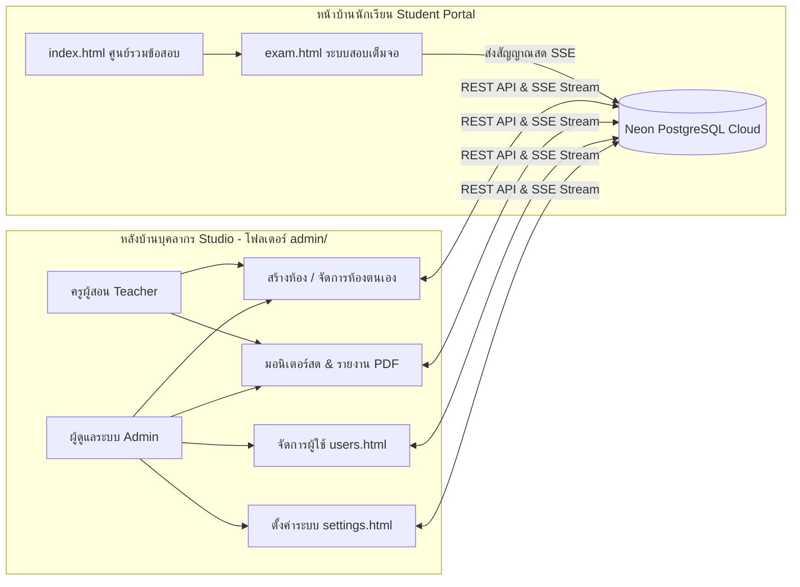

# คู่มือการใช้งานระบบ Exam Proctor Studio (v6.3)
### ระบบบริหารจัดการห้องสอบและศูนย์คุมสอบออนไลน์ระดับสถานศึกษา
**ครอบคลุมบทบาท: ครูผู้สอน / ผู้คุมสอบ (Role Teacher) และ ผู้ดูแลระบบหลัก (Role Admin)**

---

## สารบัญ (Table of Contents)

1. [บทนำและสถาปัตยกรรมระบบ (Introduction & Architecture)](#1-บทนำและสถาปัตยกรรมระบบ)
2. [ตารางเปรียบเทียบสิทธิ์การใช้งาน (Role & Permission Matrix)](#2-ตารางเปรียบเทียบสิทธิ์การใช้งาน)
3. [บทที่ 1: การเข้าสู่ระบบและการรักษาความปลอดภัย (Authentication & Security)](#บทที่-1-การเข้าสู่ระบบและการรักษาความปลอดภัย)
   - [1.1 การเข้าสู่ระบบบุคลากร (Staff Login)](#11-การเข้าสู่ระบบบุคลากร)
   - [1.2 การยืนยันตัวตนสองชั้น (TOTP 2FA Verification)](#12-การยืนยันตัวตนสองชั้น)
   - [1.3 แถบนำทางและโปรไฟล์ผู้ใช้งาน (Navigation Hub & Theme Toggle)](#13-แถบนำทางและโปรไฟล์ผู้ใช้งาน)
4. [บทที่ 2: คู่มือการใช้งานสำหรับ ครูผู้สอน / ผู้คุมสอบ (Role Teacher Manual)](#บทที่-2-คู่มือการใช้งานสำหรับ-ครูผู้สอนผู้คุมสอบ)
   - [2.1 การสร้างห้องสอบใหม่ (Create Exam Room)](#21-การสร้างห้องสอบใหม่)
   - [2.2 ความเข้าใจเรื่องรหัสผ่าน 2 ระดับ (Entry Code VS Admin Passcode)](#22-ความเข้าใจเรื่องรหัสผ่าน-2-ระดับ)
   - [2.3 การส่งต่อลิงก์และฉาย QR Code ขึ้นจอโปรเจกเตอร์](#23-การส่งต่อลิงก์และฉาย-qr-code-ขึ้นจอโปรเจกเตอร์)
   - [2.4 การจัดการห้องสอบและประวัติของตนเอง (Rooms Management)](#24-การจัดการห้องสอบและประวัติของตนเอง)
   - [2.5 ศูนย์คุมสอบสดแบบเรียลไทม์ (Real-time Live Proctoring Center)](#25-ศูนย์คุมสอบสดแบบเรียลไทม์)
   - [2.6 การอ่านจอภาพผู้สอบและการจัดการแจ้งเตือนสด](#26-การอ่านจอภาพผู้สอบและการจัดการแจ้งเตือนสด)
   - [2.7 หน้าต่างรายละเอียดผู้สอบและไทม์ไลน์เหตุการณ์ (Student Detail & Timeline)](#27-หน้าต่างรายละเอียดผู้สอบและไทม์ไลน์เหตุการณ์)
   - [2.8 คลังประวัติผู้ส่งข้อสอบและตารางบันทึกเหตุการณ์ (Exam Archives)](#28-คลังประวัติผู้ส่งข้อสอบและตารางบันทึกเหตุการณ์)
   - [2.9 แดชบอร์ดกราฟและสถิติวิเคราะห์ (Analytics Dashboard)](#29-แดชบอร์ดกราฟและสถิติวิเคราะห์)
   - [2.10 การพิมพ์รายงานสรุปผลการคุมสอบราชการ (Official PDF Report)](#210-การพิมพ์รายงานสรุปผลการคุมสอบราชการ)
   - [2.11 การส่งออกข้อมูลเป็นไฟล์ Excel / CSV](#211-การส่งออกข้อมูลเป็นไฟล์-excel--csv)
5. [บทที่ 3: คู่มือการใช้งานสำหรับ ผู้ดูแลระบบ (Role Admin Manual)](#บทที่-3-คู่มือการใช้งานสำหรับ-ผู้ดูแลระบบ)
   - [3.1 การกำกับดูแลห้องสอบรวมทั้งระบบ (System-wide Rooms Oversight)](#31-การกำกับดูแลห้องสอบรวมทั้งระบบ)
   - [3.2 การใช้งานตัวกรองผู้สร้างห้องสอบ (Creator Filter)](#32-การใช้งานตัวกรองผู้สร้างห้องสอบ)
   - [3.3 การเริ่มรอบสอบใหม่และการตัดรอบข้อมูล (Reset Session)](#33-การเริ่มรอบสอบใหม่และการตัดรอบข้อมูล)
   - [3.4 ระบบจัดการบัญชีผู้ใช้งาน (User Management)](#34-ระบบจัดการบัญชีผู้ใช้งาน)
   - [3.5 การเพิ่ม แก้ไข ระงับ และรีเซ็ตรหัสผ่านผู้ใช้งาน](#35-การเพิ่ม-แก้ไข-ระงับ-และรีเซ็ตรหัสผ่านผู้ใช้งาน)
   - [3.6 การตั้งค่าระบบกลางและการเชื่อมต่อ Cloud Database (System Settings)](#36-การตั้งค่าระบบกลางและการเชื่อมต่อ-cloud-database)
6. [บทที่ 4: การแก้ไขปัญหาและคำถามที่พบบ่อย (Troubleshooting & FAQ)](#บทที่-4-การแก้ไขปัญหาและคำถามที่พบบ่อย)

---

## 1. บทนำและสถาปัตยกรรมระบบ

**Exam Proctor Studio (v6.3)** ได้รับการออกแบบให้เป็นแพลตฟอร์มบริหารจัดการและคุมสอบออนไลน์แบบครบวงจร รองรับแบบทดสอบ Google Forms ทุกรูปแบบ โดยแบ่งโครงสร้างการทำงานออกเป็น 2 ส่วนหลัก:

### จุดเด่นด้านความปลอดภัยและประสิทธิภาพ
- **ระบบสตรีมมิ่งสด Ultra Low-Latency SSE (<1s)**: หน้าจอคุมสอบจะอัปเดตสถานะนักเรียนแบบเรียลไทม์ทันทีที่มีการสลับหน้าจอ โดยไม่ต้องกดรีเฟรช
- **ระบบความปลอดภัยระดับสากล**: แฮชรหัสผ่านด้วยอัลกอริทึม Scrypt (RFC 7914) ป้องกันการโจมตี Brute-force พร้อมระบบยืนยันตัวตนสองชั้น (TOTP 2FA)
- **เครื่องยนต์ป้องกันการทุจริต (Anti-Cheating Engine)**: บังคับโหมดเต็มจอ, ตรวจจับการสลับแท็บ/ย่อหน้าต่าง, บล็อกคีย์ลัด Copy/Paste, ตรวจจับคลิกเมาส์ออกนอกหน้าจอ และบันทึกเวลาที่หลุดออกไปเป็นวินาที

---

## 2. ตารางเปรียบเทียบสิทธิ์การใช้งาน (Role & Permission Matrix)

| เมนู / คุณสมบัติการทำงาน | ครูผู้สอน (Teacher) | ผู้ดูแลระบบ (Admin) | คำอธิบายและข้อกำหนด |
| :--- | :---: | :---: | :--- |
| **การเข้าสู่ระบบ & 2FA** | ✔ | ✔ | รองรับ Google/Microsoft Authenticator |
| **สร้างห้องสอบใหม่** | ✔ | ✔ | ครอบ Google Forms ได้ทุกรูปแบบ |
| **รหัสผ่าน 2 ระดับ** | ✔ | ✔ | Entry Code (นักเรียน) และ Admin Passcode (ครู) |
| **สิทธิ์ดูรายการห้องสอบ** | เฉพาะห้องของตนเอง | ทุกห้องในระบบ | Admin มีแถบตัวกรองผู้สร้าง (*Creator Filter*) |
| **เปิด/ปิดรับนักเรียน (Status)** | เฉพาะห้องของตนเอง | ทุกห้องในระบบ | อัปเดตสถานะแบบ Real-time ทันที |
| **ฉาย QR Code & คัดลอกลิงก์** | ✔ | ✔ | ดาวน์โหลดรูปภาพ QR Code ได้ |
| **ศูนย์คุมสอบสด (Live Monitor)** | เฉพาะห้องของตนเอง | ทุกห้องในระบบ | แสดงหน้าจอนักเรียนและเสียงเตือนไซเรน |
| **จัดการเหตุการณ์สดรายคน** | ✔ | ✔ | กด "ตรวจสอบแล้ว" หรือ "สั่งจบการสอบ" |
| **ตัดรอบสอบใหม่ (Reset Session)** | ❌ ซ่อนปุ่ม | ✔ ทำได้ | ย้ายนักเรียนสดเข้าคลังประวัติทันที |
| **รายงานสรุปผลราชการ (PDF)** | ✔ | ✔ | แบบฟอร์มราชการพร้อมช่องลงนามกรรมการ |
| **ส่งออกข้อมูลประวัติ (CSV)** | ✔ | ✔ | รองรับภาษาไทยเปิดใน Excel ได้ทันที |
| **เมนูจัดการผู้ใช้ (`users.html`)** | ❌ เข้าถึงไม่ได้ | ✔ สิทธิ์เต็ม | เพิ่ม/แก้ไข/ลบ/เปลี่ยนสิทธิ์/รีเซ็ตรหัสผ่าน |
| **เมนูตั้งค่าระบบ (`settings.html`)** | ❌ เข้าถึงไม่ได้ | ✔ สิทธิ์เต็ม | เปลี่ยนชื่อระบบ, ประกาศหน้านักเรียน, รหัสกลาง |

---

## บทที่ 1: การเข้าสู่ระบบและการรักษาความปลอดภัย

### 1.1 การเข้าสู่ระบบบุคลากร

1. เปิดเว็บเบราว์เซอร์ไปที่ลิงก์หลังบ้าน เช่น `http://your-domain/admin/login.html`
2. **กรอกชื่อผู้ใช้ (Username)**: เช่น `teacher` หรือ `admin`
3. **กรอกรหัสผ่าน (Password)**: รหัสผ่านต้องมีความยาวอย่างน้อย 8 ตัวอักษรขึ้นไป
4. **ปุ่มแสดง/ซ่อนรหัสผ่าน**: สามารถคลิกเพื่อตรวจสอบความถูกต้องของการสะกดรหัสผ่าน
5. คลิกปุ่ม **"เข้าสู่ระบบ"**

> [!NOTE]
> รหัสผ่านเข้าสู่ระบบหลังบ้าน (ความยาว 8 หลักขึ้นไป) แยกขาดจากรหัสผ่านผู้คุมสอบ (Admin Passcode 6 หลัก) เพื่อความปลอดภัยสูงสุด

---

### 1.2 การยืนยันตัวตนสองชั้น (TOTP 2FA Verification)

หากบัญชีของท่านเปิดใช้งานระบบยืนยันตัวตน 2 ชั้น (Two-Factor Authentication):
1. เมื่อกรอกชื่อผู้ใช้และรหัสผ่านถูกต้อง ระบบจะแสดงหน้าต่างป็อปอัป **"ยืนยันตัวตน 2 ชั้น (2FA)"**
2. เปิดแอป **Google Authenticator** หรือ **Microsoft Authenticator** บนสมาร์ตโฟนของท่าน
3. นำรหัสตัวเลข 6 หลักที่ปรากฏในแอปมากรอกลงในช่องข้อความ
4. คลิกปุ่ม **"ยืนยันรหัสความปลอดภัย"** เพื่อเข้าสู่ระบบหลังบ้าน

---

### 1.3 แถบนำทางและโปรไฟล์ผู้ใช้งาน (Navigation Hub)

เมื่อเข้าสู่ระบบสำเร็จ แถบเมนูด้านบน (Navbar) จะแสดงผลตามระดับสิทธิ์ของผู้ใช้งาน:
- **มุมมองครูผู้สอน (Role Teacher)**: จะเห็น 3 เมนูหลัก ได้แก่ **สร้างห้องสอบ**, **หน้าจอคุมสอบสด**, และ **จัดการห้องสอบ**
- **มุมมองผู้ดูแลระบบ (Role Admin)**: จะเห็นครบทั้ง 5 เมนู เพิ่มเติมคือ **จัดการผู้ใช้** และ **ตั้งค่าระบบ**
- **Badge แสดงสิทธิ์**:
  - สีน้ำเงิน `ครูผู้สอน` พร้อมชื่อ-นามสกุลครู
  - สีแดง `ผู้ดูแลระบบ` สำหรับบัญชี Admin
- **ปุ่มสลับโหมดมืด/สว่าง (Theme Toggle)**: คลิกเพื่อสลับโทนสีหน้าจอตามความสบายตา
- **ปุ่ม "หน้าบ้าน"**: เปิดหน้าศูนย์รวมข้อสอบนักเรียน (`index.html`) ในแท็บใหม่
- **ปุ่ม "ออกจากระบบ"**: แสดงหน้าต่างยืนยันก่อนเคลียร์ Session ออกจากระบบอย่างปลอดภัย

---

## บทที่ 2: คู่มือการใช้งานสำหรับ ครูผู้สอน / ผู้คุมสอบ

### 2.1 การสร้างห้องสอบใหม่ (Create Exam Room)

ไปยังเมนู **"สร้างห้องสอบ"** (`admin/create.html`) และกรอกข้อมูลตามลำดับ:
1. **ชื่อวิชา หรือหัวข้อการสอบ**: กรอกชื่อวิชาให้ชัดเจน เช่น *"แบบทดสอบวิชาคณิตศาสตร์ ม.3 กลางภาคเรียนที่ 1"*
2. **กลุ่มสาระการเรียนรู้ / หมวดหมู่**: เลือกหมวดหมู่วิชา เช่น คณิตศาสตร์, วิทยาศาสตร์, ภาษาต่างประเทศ ฯลฯ
3. **ระดับชั้นการศึกษา**: เลือกระดับชั้นของผู้เข้าสอบ เช่น มัธยมศึกษาปีที่ 3
4. **ลิงก์ Google Forms ข้อสอบ**: วางลิงก์ Google Forms ได้ทุกรูปแบบ (ทั้งลิงก์ยาว `docs.google.com/forms/...` หรือลิงก์สั้น `forms.gle/...`) ระบบจะทำการปรับแต่งเพื่อนำไปครอบในหน้าจอคุมสอบให้อัตโนมัติ
5. **สถานะเปิดรับนักเรียน**:
   - `OPEN`: เปิดให้นักเรียนค้นหาและเข้าสอบได้ทันที
   - `CLOSED`: บันทึกห้องไว้ล่วงหน้า แต่นักเรียนจะยังเข้าทำข้อสอบไม่ได้จนกว่าครูจะเปิดระบบ

---

### 2.2 ความเข้าใจเรื่องรหัสผ่าน 2 ระดับ

ระบบ Exam Proctor Studio ใช้สถาปัตยกรรมความปลอดภัยแบบ **Dual-Passcode System**:

| ประเภทของรหัสผ่าน | สีของการ์ด | จำนวนหลัก | กลุ่มเป้าหมายที่ใช้งาน | หน้าที่การทำงาน |
| :--- | :---: | :---: | :---: | :--- |
| **รหัสเข้าห้องสอบ (Entry Code)** | สีน้ำเงิน | 6 หลัก | **นักเรียน** | รหัสที่ครูแจ้งให้นักเรียนกรอกเพื่อปลดล็อกเข้าสู่ห้องสอบจากหน้ารวมข้อสอบ |
| **รหัสผ่านผู้คุมสอบ (Admin Passcode)** | สีแดง | 6 หลัก | **ครูผู้คุมสอบเท่านั้น** | รหัสลับเฉพาะครูสำหรับเดินไปกดปลดล็อกหน้าจอเครื่องนักเรียนกรณีเกิดเหตุจำเป็น |

> [!TIP]
> ท่านสามารถกดปุ่ม **"สุ่มใหม่"** ข้างช่องรหัสผ่าน เพื่อให้ระบบสร้างรหัสผ่านชุดใหม่ที่ไม่ซ้ำกันให้อัตโนมัติ

---

### 2.3 การส่งต่อลิงก์และฉาย QR Code ขึ้นจอโปรเจกเตอร์

เมื่อกรอกข้อมูลครบถ้วนแล้ว ให้คลิกปุ่ม **"สร้างห้องสอบและบันทึกลงระบบ"** ระบบจะแสดงกล่องผลลัพธ์:

1. **คัดลอกลิงก์ตรง (Direct Exam Link)**: คลิกปุ่ม *"คัดลอกลิงก์"* เพื่อนำไปส่งในกลุ่มแชท, Line, หรือ Google Classroom นักเรียนสามารถคลิกลิงก์เพื่อเข้าสู่หน้าจอสอบได้ทันทีโดยไม่ต้องค้นหา
2. **ฉาย QR Code ขึ้นจอขนาดใหญ่ (Projector QR Code)**:

- คลิกปุ่ม **"ฉาย QR Code ขยายใหญ่"** หรือคลิกที่รูป QR Code
- หน้าจอจะแสดง QR Code ขนาดใหญ่ คมชัด สแกนติดง่าย พร้อมระบุชื่อวิชาและรหัสเข้าสอบ 6 หลักอย่างเด่นชัด เหมาะสำหรับฉายขึ้นจอโปรเจกเตอร์หน้าห้องสอบ
- สามารถคลิกปุ่ม **"บันทึกรูปภาพ QR (.png)"** เพื่อนำไฟล์รูปไปแทรกในเอกสารใบงานหรือพิมพ์แจกนักเรียน

---

### 2.4 การจัดการห้องสอบและประวัติของตนเอง (Rooms Management)

เข้าสู่เมนู **"จัดการห้องสอบ"** (`admin/rooms.html`):
- **แถบระบุสิทธิ์ (Scope Badge)**: ครูผู้สอนจะเห็นป้ายสีน้ำเงินระบุ *"สิทธิ์ครู: แสดงเฉพาะห้องสอบของ [ชื่อครู]"* มั่นใจได้ว่าข้อมูลห้องสอบจะไม่ปะปนกับครูท่านอื่น
- **แถบเครื่องมือค้นหาและกรองข้อมูล**:
  - ช่องพิมพ์ค้นหาชื่อวิชา หรือรหัสห้องสอบ 6 หลัก
  - ตัวกรองกลุ่มสาระการเรียนรู้, ระดับชั้น และสถานะห้อง
- **การควบคุมบนการ์ดห้องสอบ (Room Card Actions)**:
  - **สวิตช์สถานะห้อง**: คลิกเพื่อเปลี่ยนสถานะระหว่าง `OPEN` (เปิดสอบ) และ `CLOSED` (ปิดสอบ) ได้ทันที
  - **ปุ่มคัดลอกลิงก์**: คัดลอกลิงก์เข้าสอบของห้องนั้นๆ
  - **ปุ่มแสดง QR Code**: เปิดหน้าต่างฉาย QR Code ของห้องนั้นขึ้นจอ
  - **ปุ่มเริ่มทดสอบ (Launch)**: เปิดหน้าจอสอบเพื่อทดสอบระบบเสมือนเป็นนักเรียน
  - **ปุ่มแก้ไข (Edit)**:

  - **ปุ่มลบห้องสอบ (Delete)**:

---

### 2.5 ศูนย์คุมสอบสดแบบเรียลไทม์ (Live Proctoring Center)

เข้าสู่เมนู **"หน้าจอคุมสอบสด"** (`admin/monitor.html`) ซึ่งเป็นหัวใจสำคัญในการกำกับดูแลความโปร่งใส:
1. **แถบสลับหมวดหลัก**: สลับระหว่าง `1. ศูนย์คุมสอบสด (Live Proctoring)` และ `2. คลังประวัติและรายงานย้อนหลัง`
2. **แถบสถานะสด (Live Incident Ticker)**: แถบสีด้านบนจะแสดงข้อความสรุปสถานะการสอบสดทันที เช่น แสดงป้าย *"สถานะปกติ"* เมื่อทุกคนทำข้อสอบในโหมดเต็มจอ หรือเปลี่ยนเป็นสีแดงพร้อมแจ้งเตือนทันทีเมื่อมีผู้สอบสลับจอ
3. **การ์ดสถิติสด 4 มิติ (Live Stats Strip)**:
   - **ทั้งหมดรอบสด**: จำนวนผู้เข้าสอบทั้งหมดที่กำลังเชื่อมต่อในรอบนี้
   - **กำลังสอบสด**: จำนวนผู้สอบที่กำลังทำข้อสอบอยู่ ณ วินาทีนี้ (สถานะปกติ)
   - **แจ้งเตือนสลับจอสด**: สถิติจำนวนครั้งรวมที่ระบบตรวจพบพฤติกรรมผิดปกติ
   - **ส่งข้อสอบแล้ว**: จำนวนผู้ที่กดส่งแบบทดสอบเรียบร้อยแล้วในรอบนี้

---

### 2.6 การอ่านจอภาพผู้สอบและการจัดการแจ้งเตือนสด

- **ตัวกรองห้องสอบ**: สามารถคลิกเลือกเพื่อดูเฉพาะห้องสอบที่ท่านกำลังคุมอยู่
- **ปุ่มเสียงเตือน (Sound Alert Toggle)**: สามารถคลิกเปิด/ปิดเสียงไซเรนแจ้งเตือนเมื่อตรวจพบการสลับหน้าจอ
- **แถบ Filter Pills**: เลือกว่าจะแสดง *"ทั้งหมด"*, *"พบแจ้งเตือน"* (แสดงเฉพาะคนที่มีปัญหา), หรือ *"เฉพาะวันนี้"*

- **การ์ดสีเขียว (สถานะปกติ)**: นักเรียนอยู่ในโหมดเต็มหน้าจอ ทำข้อสอบอย่างซื่อสัตย์ ตัวเลขนับเวลาเดินต่อเนื่อง
- **การ์ดสีกะพริบแดง (พบการแจ้งเตือน)**: ตรวจพบว่านักเรียนหลุดออกจากโหมดเต็มจอ สลับแท็บ หรือคลิกเมาส์ออกนอกหน้าต่าง พร้อมตัวเลขระบุจำนวนครั้งที่เกิดเหตุอย่างชัดเจน

---

### 2.7 หน้าต่างรายละเอียดผู้สอบและไทม์ไลน์เหตุการณ์

เมื่อคลิกที่การ์ดหน้าจอของนักเรียนคนใดก็ตาม ระบบจะเปิดหน้าต่าง **"รายละเอียดจอผู้สอบ"**:
1. **สรุปสถิติส่วนหัว**: สถานะปัจจุบัน, จำนวนครั้งที่แจ้งเตือน, เวลาที่เริ่มสอบ และเวลาที่เกิดเหตุการณ์ล่าสุด
2. **ไทม์ไลน์เหตุการณ์ (Event Timeline)**: บันทึกประวัติอย่างละเอียดระดับวินาที เช่น:
   - `10:15:02`: เริ่มทำข้อสอบ เข้าสู่โหมดเต็มหน้าจอสำเร็จ
   - `10:22:14`: หลุดออกจากโหมดเต็มหน้าจอ (ออกจากหน้าจอ 4 วินาที)
   - `10:28:30`: สลับแท็บเบราว์เซอร์ออกไปหน้าอื่น
3. **ปุ่มสั่งการสำคัญ**:
   - **"ตรวจสอบแล้ว" (Acknowledge Alert)**: เมื่อครูเดินไปตักเตือนหรือตรวจสอบแล้ว ให้คลิกปุ่มนี้เพื่อรีเซ็ตสถานะหน้าจอของนักเรียนให้กลับเป็นสีเขียวปกติ
   - **"สั่งจบการสอบ" (Force End Exam)**: กรณีนักเรียนเจตนาทุจริต หรือเครื่องค้าง ครูสามารถคลิกปุ่มนี้เพื่อตัดสิทธิ์และยุติการสอบของนักเรียนคนดังกล่าวได้ทันที

---

### 2.8 คลังประวัติผู้ส่งข้อสอบและตารางบันทึกเหตุการณ์ (Exam Archives)

เมื่อคลิกแท็บ **"2. คลังประวัติและรายงานย้อนหลัง"** ที่แถบด้านบน ระบบจะสลับเข้าสู่โหมดคลังประวัติ:

- **มุมมองประวัติผู้ส่งข้อสอบแล้ว (Completed Grid)**: แสดงการ์ดผู้ที่ทำข้อสอบเสร็จสิ้น โดยระบบจะทำการจัดกลุ่มแยกตามวันที่จัดสอบให้อัตโนมัติ สามารถเลือกดูเฉพาะวันที่ต้องการได้

- **มุมมองตารางประวัติเหตุการณ์ (Audit Log Table)**: แสดงรายการบันทึกเหตุการณ์ทั้งหมดตามลำดับเวลา พร้อมรหัสประจำตัว และประเภทเหตุการณ์ เหมาะสำหรับการตรวจสอบ Audit Trail ย้อนหลัง

---

### 2.9 แดชบอร์ดกราฟและสถิติวิเคราะห์ (Analytics Dashboard)

คลิกที่ปุ่มมุมมอง **"สถิติและกราฟวิเคราะห์"** ระบบจะประมวลผลข้อมูลเชิงสถิติ:
1. **ดัชนีความซื่อสัตย์ของการสอบ (Integrity Rate)**: คิดเป็นเปอร์เซ็นต์ของผู้เข้าสอบที่ไม่มีประวัติการแจ้งเตือนสลับหน้าจอเลย
2. **เวลาทำข้อสอบเฉลี่ย (Avg Duration)**: ระยะเวลาเฉลี่ยตั้งแต่เริ่มสอบจนถึงส่งข้อสอบ
3. **กราฟไทม์ไลน์ความถี่การเกิดเหตุการณ์ (Incidents Over Time)**: แสดงช่วงเวลาที่มีการหลุดเต็มจอหรือสลับแท็บมากที่สุด เพื่อนำไปวิเคราะห์ความยากง่ายของข้อสอบในแต่ละช่วง
4. **กราฟจำแนกประเภทเหตุการณ์ (Violation Types)**: สัดส่วนระหว่างการหลุดเต็มจอ, การสลับแท็บ และการคลิกออกนอกหน้าต่าง

---

### 2.10 การพิมพ์รายงานสรุปผลการคุมสอบราชการ (Official PDF Report)

ในโหมดคลังประวัติ ให้คลิกปุ่ม **"พิมพ์รายงาน PDF"**:
1. ระบบจะเปิดหน้าต่างเอกสารทางการตามระเบียบงานสารบรรณ
2. **ข้อมูลส่วนหัว**: ชื่อสถานศึกษา, รหัสห้องสอบ, กลุ่มสาระการเรียนรู้, ระดับชั้น, วันที่จัดสอบ, ชื่อผู้สร้างห้องสอบ และชื่อผู้คุมสอบ/ผู้พิมพ์รายงาน
3. **ตารางสรุปสถิติตัวเลข**: จำนวนผู้เข้าสอบ, จำนวนผู้ส่งสำเร็จ, อัตราความซื่อสัตย์ และสถิติการแจ้งเตือน
4. **ตารางบันทึกรายบุคคล**: แสดงรายชื่อ รหัสนักเรียน เวลาเริ่ม-ส่งข้อสอบ จำนวนครั้งที่เตือน และสถานะสรุป
5. **ส่วนลงนามรับรอง**: มีช่องสำหรับลงลายมือชื่อของกรรมการผู้คุมสอบคนที่ 1, กรรมการผู้คุมสอบคนที่ 2 และหัวหน้าฝ่ายวิชาการ/วัดผล
6. คลิกปุ่ม **"สั่งพิมพ์ / บันทึก PDF"** เพื่อสั่งพิมพ์ออกเครื่องพิมพ์ หรือเลือกปลายทางเป็น *"Save as PDF"* เพื่อบันทึกเป็นไฟล์เอกสารแนบรายงานผลการเรียน

---

### 2.11 การส่งออกข้อมูลเป็นไฟล์ Excel / CSV

- ในโหมดคลังประวัติ ให้คลิกปุ่ม **"ส่งออก CSV"**
- เบราว์เซอร์จะดาวน์โหลดไฟล์ `.csv` ที่บันทึกประวัตินักเรียนทุกคน เวลาที่สอบ และเหตุการณ์ที่เกิดขึ้น
- ไฟล์เข้ารหัส UTF-8 พร้อม BOM ทำให้สามารถดับเบิลคลิกเปิดในโปรแกรม **Microsoft Excel** ได้ทันทีโดยภาษาไทยไม่เพี้ยน สะดวกต่อการนำไปคำนวณตัดเกรดหรือทำรายงานวิจัยในชั้นเรียน

---

## บทที่ 3: คู่มือการใช้งานสำหรับ ผู้ดูแลระบบ

### 3.1 การกำกับดูแลห้องสอบรวมทั้งระบบ (System Oversight)

เมื่อเข้าสู่ระบบด้วยสิทธิ์ผู้ดูแลระบบ (Admin) หน้า **"จัดการห้องสอบ"** จะแสดงคุณสมบัติพิเศษระดับสูง:
- **Badge สิทธิ์สีแดง**: ระบุ *"สิทธิ์ Admin: แสดงห้องสอบทั้งหมดในระบบ (All Rooms)"* ทำให้ Admin สามารถมองเห็นห้องสอบของครูทุกคนในสถานศึกษา
- **สิทธิ์การเข้าแทรกแซง**: Admin สามารถกดเปิด/ปิดสถานะห้องสอบ, แก้ไขข้อมูลวิชา หรือลบห้องสอบใดๆ ในระบบได้ทันทีในกรณีที่ครูผู้สอนติดภารกิจฉุกเฉิน

---

### 3.2 การใช้งานตัวกรองผู้สร้างห้องสอบ (Creator Filter)

- ในหน้ารายการห้องสอบสิทธิ์ Admin จะปรากฏเมนูดรอปดาวน์ **"ทุกผู้สร้างห้องสอบ"** เพิ่มขึ้นมา
- Admin สามารถเลือกคลิกเพื่อกรองดูเฉพาะห้องสอบของครูท่านใดท่านหนึ่งได้ทันที สะดวกต่อการติดตามการทำงานของครูในแต่ละกลุ่มสาระ

---

### 3.3 การเริ่มรอบสอบใหม่และการตัดรอบข้อมูล (Reset Session)

ในหน้าจอ **"หน้าจอคุมสอบสด"** (`admin/monitor.html`) เฉพาะสิทธิ์ Admin จะมีปุ่มคำสั่งพิเศษ:
- **ปุ่ม "เริ่มรอบใหม่" (Reset Session)**:
  - ใช้เมื่อสิ้นสุดการสอบในคาบเรียน หรือต้องการเริ่มสอบวิชาใหม่ในรอบบ่าย
  - เมื่อคลิกยืนยัน ระบบจะทำการย้ายหน้าจอผู้สอบสดชุดเดิมทั้งหมดเข้าสู่คลังประวัติ (Archive) และเปิดหน้าจอคุมสอบสดให้ว่างเปล่า พร้อมสำหรับนักเรียนรอบถัดไปทันที โดยข้อมูลของรอบก่อนหน้าจะไม่สูญหาย
- **ปุ่ม "ทดสอบ API"**: สำหรับทดสอบการเชื่อมต่อส่ง Ping ไปยังเซิร์ฟเวอร์ฐานข้อมูล Postgres เพื่อตรวจสอบความพร้อมของระบบก่อนเริ่มการสอบใหญ่

---

### 3.4 ระบบจัดการบัญชีผู้ใช้งาน (User Management)

เข้าสู่เมนู **"จัดการผู้ใช้"** (`admin/users.html`) ซึ่งเข้าถึงได้เฉพาะสิทธิ์ Admin เท่านั้น:
- **ตารางแสดงบัญชีผู้ใช้**: แสดงชื่อผู้ใช้ (Username), ชื่อที่แสดงผล (Display Name), บทบาท (Admin หรือ Teacher), สถานะความปลอดภัย, สถานะบัญชี (ใช้งานได้ / ระงับการใช้งาน) และวัน-เวลาที่เข้าสู่ระบบล่าสุด
- **แถบเครื่องมือค้นหาและกรอง**: ค้นหาด้วยชื่อหรือ Username, กรองตามบทบาท, และกรองตามสถานะบัญชี

---

### 3.5 การเพิ่ม แก้ไข ระงับ และรีเซ็ตรหัสผ่านผู้ใช้งาน

#### 1. การเพิ่มผู้ใช้งานใหม่:
- คลิกปุ่ม **"เพิ่มผู้ใช้งานใหม่"** ที่มุมขวาบน
- กรอก **ชื่อผู้ใช้ (Username)**: แนะนำให้ใช้ตัวพิมพ์เล็กภาษาอังกฤษ เช่น `teacher_somchai`
- กรอก **ชื่อ-นามสกุลที่แสดงผล**: เช่น `อาจารย์สมชาย ใจดี`
- เลือก **บทบาท (Role)**: เลือกระหว่าง `ครูผู้สอน (Teacher)` หรือ `ผู้ดูแลระบบ (Admin)`
- กำหนด **รหัสผ่านเข้าสู่ระบบ**: ความยาวอย่างน้อย 8 ตัวอักษรขึ้นไป
- คลิกปุ่มบันทึก ระบบจะนำไปเข้ารหัส Scrypt และบันทึกลงฐานข้อมูลทันที

#### 2. การแก้ไขและรีเซ็ตรหัสผ่าน:
- คลิกปุ่ม **"แก้ไข"** ที่แถวของผู้ใช้ที่ต้องการ
- สามารถปรับเปลี่ยนชื่อที่แสดงผล, สลับบทบาทระหว่าง Teacher และ Admin หรือเปลี่ยนสถานะเป็น *"ระงับการใช้งาน"* กรณีครูย้ายสถานศึกษา
- หากต้องการรีเซ็ตรหัสผ่าน ให้กรอกรหัสผ่านใหม่ในช่อง *"รหัสผ่านใหม่"* แล้วกดบันทึก

> [!WARNING]
> ระบบมีมาตรการป้องกันความปลอดภัยสูง โดยจะ **ไม่อนุญาตให้ลบหรือระงับบัญชี Master Admin หลัก (`admin` / `USR-ADMIN`)** เพื่อป้องกันความผิดพลาดจากการล็อคตัวเองออกจากระบบ

---

### 3.6 การตั้งค่าระบบกลางและการเชื่อมต่อ Cloud Database (System Settings)

เข้าสู่เมนู **"ตั้งค่าระบบ"** (`admin/settings.html`) เพื่อควบคุมตัวแปรกำกับดูแลระดับองค์กร:
1. **ชื่อระบบ / สถาบันการศึกษา (System Name)**:
   - กรอกชื่อโรงเรียนหรือวิทยาลัย เช่น *"โรงเรียนสาธิตวิทยาคม"*
   - ชื่อนี้จะไปปรากฏที่แถบส่วนหัว (Navbar) ของทุกหน้า และเป็นชื่อหัวกระดาษในรายงานสรุปผลการคุมสอบราชการ
2. **ข้อความประกาศบนหน้าศูนย์สอบนักเรียน (Portal Announcement)**:
   - กำหนดข้อความแจ้งเตือนแก่นักเรียนที่จะปรากฏที่หน้าแรกของศูนย์สอบ เช่น ระเบียบการสอบ ข้อกำหนดเวลา หรือคำตักเตือนเรื่องการสลับหน้าจอ
3. **รหัสผ่านกลางผู้ดูแลระบบ (Master Admin Passcode)**:
   - รหัสผ่านฉุกเฉินระดับสูงสุด (Master Key) สำหรับผู้ดูแลระบบ สามารถใช้เดินไปปลดล็อกหน้าจอเครื่องนักเรียนได้ทุกห้องสอบทั่วทั้งสถาบัน
4. **รหัสผ่านครูผู้สอนตั้งต้น (Teacher Passcode)**:
   - รหัสผ่านสำรองสำหรับห้องสอบที่สร้างขึ้นใหม่
5. **ที่อยู่ Cloud Webhook URL / Database API Endpoint**:
   - กำหนดที่อยู่ API สำหรับซิงก์ข้อมูล เช่น `https://your-app.vercel.app/api` เชื่อมต่อกับฐานข้อมูล Neon Serverless PostgreSQL
6. คลิกปุ่ม **"บันทึกการตั้งค่าระบบ"** ข้อมูลจะถูกบันทึกลงเครื่องและส่งอัปเดตไปยัง Cloud Database ส่วนกลางทันที

---

## บทที่ 4: การแก้ไขปัญหาและคำถามที่พบบ่อย (Troubleshooting & FAQ)

### Q1: นักเรียนเผลอกดปิดหน้าต่างสอบ หรือเครื่องคอมพิวเตอร์ดับกลางคัน ต้องแก้ไขอย่างไร?
**คำตอบ**:
- ให้นักเรียนเปิดเบราว์เซอร์ขึ้นมาใหม่ แล้วเข้าลิงก์ห้องสอบเดิมหรือสแกน QR Code อีกครั้ง
- ระบบจะจดจำและให้นักเรียนทำแบบทดสอบต่อจากจุดเดิมได้ทันที
- ประวัติการหลุดออกจากหน้าจอจะถูกบันทึกลงใน Timeline เพื่อให้ครูผู้คุมสอบรับทราบและตรวจสอบความโปร่งใส

### Q2: หน้าจอนักเรียนล็อคหรือขึ้นเตือนให้ใส่รหัสปลดล็อก ครูต้องทำอย่างไร?
**คำตอบ**:
- ให้ครูผู้คุมสอบเดินไปที่เครื่องของนักเรียน
- กรอก **รหัสผ่านผู้คุมสอบ (Admin Passcode 6 หลัก)** ประจำห้องสอบนั้นๆ (ดูได้จากการ์ดสีแดงในหน้าสร้างห้องสอบหรือหน้ารายการห้องสอบ)
- หรือหากเป็นผู้ดูแลระบบ สามารถใช้ **Master Admin Passcode** ปลดล็อกได้ทันที

### Q3: ทำไมหน้าจอคุมสอบสดถึงไม่มีเสียงแจ้งเตือนไซเรนเมื่อนักเรียนสลับหน้าจอ?
**คำตอบ**:
- ตรวจสอบปุ่ม **"เสียงเตือน"** ที่แถบควบคุมด้านบนของหน้าคุมสอบสดว่าอยู่ในสถานะ *"เสียงเตือน: เปิด"* หรือไม่
- เบราว์เซอร์ยุคใหม่ (เช่น Chrome/Edge) มีนโยบาย Autoplay Policy: ครูจะต้องมีการคลิกที่หน้าเว็บอย่างน้อย 1 ครั้งหลังจากโหลดหน้าเว็บ เพื่ออนุญาตให้เบราว์เซอร์เล่นเสียงแจ้งเตือนได้

### Q4: หากครูลืมรหัสผ่านเข้าสู่ระบบหลังบ้าน จะต้องทำอย่างไร?
**คำตอบ**:
- ให้ติดต่อผู้ดูแลระบบหลัก (Admin) ของสถานศึกษา
- ผู้ดูแลระบบสามารถเข้าเมนู **"จัดการผู้ใช้" (`admin/users.html`)** ค้นหาชื่อของครูท่านนั้น แล้วกดปุ่ม **"แก้ไข"** เพื่อตั้งรหัสผ่านใหม่ (Reset Password) ได้ทันทีในเวลาไม่เกิน 1 นาที

### Q5: พิมพ์รายงานราชการเป็น PDF แล้วฟอนต์สระลอย หรือหน้ากระดาษล้น ต้องตั้งค่าอย่างไร?
**คำตอบ**:
- ระบบได้รับการปรับแต่งฟอนต์สารบรรณ (TH Sarabun PSK) ที่ถูกต้องตามมาตรฐานราชการ
- ในหน้าต่างสั่งพิมพ์ของ Google Chrome / Microsoft Edge ให้ตั้งค่าดังนี้:
  - **ขนาดกระดาษ (Paper size)**: A4
  - **ระยะขอบ (Margins)**: ค่าเริ่มต้น (Default) หรือ ต่ำสุด (Minimum)
  - **ตัวเลือกเพิ่มเติม (Options)**: ติ๊กเลือกถูกที่ *"กราฟิกพื้นหลัง (Background graphics)"* เพื่อให้สีแถบตารางและตราสัญลักษณ์แสดงผลอย่างสมบูรณ์แบบ

---

*เอกสารคู่มือการใช้งานระบบ Exam Proctor Studio (v6.3) — จัดทำและรับรองมาตรฐานโดยคณะทำงานพัฒนาระบบคุมสอบออนไลน์*
